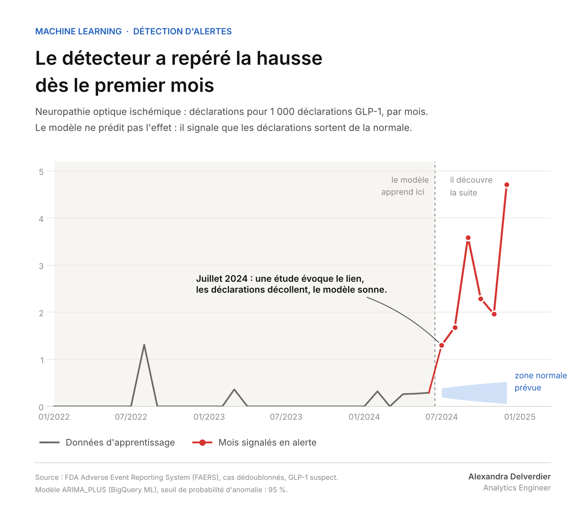
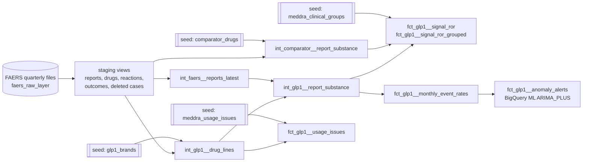

# FAERS x GLP-1: pharmacovigilance analytics with dbt, BigQuery and BigQuery ML

An end-to-end analytics engineering project on the FDA Adverse Event Reporting System (FAERS), focused on GLP-1 receptor agonists (Ozempic, Wegovy, Mounjaro, Zepbound, Foundayo...).

It covers the full chain: raw quarterly FAERS files loaded into BigQuery, a tested dbt project that cleans and models the data, disproportionality analysis (ROR), and a time-series anomaly detector built with BigQuery ML and validated on real safety alerts.

Built by a former nurse turned analytics engineer: the clinical reading of the data (MedDRA coding, drug forms, reporting context) is part of the method, not an afterthought.

---

## Key findings

### 1. From pen to pill: fewer administration errors, more disappointment

Share of adverse event reports (H1 2026) mentioning an administration error or perceived inefficacy, comparing the injectable and the oral form from the same manufacturer.

| Product | Form | Administration errors | Perceived inefficacy |
|---|---|---|---|
| Wegovy | injectable | 22.5 % | 8.4 % |
| Wegovy | oral | 4.6 % | 29.0 % |
| Zepbound | injectable | 18.3 % | 10.2 % |
| Foundayo | oral | 2.6 % | 24.9 % |

The oral forms cut administration errors by 5 to 7, while reports of "drug ineffective" or "weight loss poor" rise sharply. Digestive effects remain (nausea in 20 to 25 % of oral-form reports).


### 2. An anomaly detector validated on real alerts

An ARIMA_PLUS model (BigQuery ML) learns the normal monthly reporting rate for each clinical group and flags unusual increases. To test it honestly, it was trained only on data available before each event, then shown the following months as new data.

> **What the detector does, and what it does not do**
>
> It does **not predict** adverse effects. It works like a patient monitor: it learns the usual pattern, then raises an alarm as soon as new reports fall outside the expected range.
>
> It detects **a change in reporting, not a risk**. In July 2024, optic neuropathy reports rose because a study had just linked the condition to semaglutide: the model caught the reaction to that study, the same month. It could not have flagged it earlier, because almost nothing was being reported before.
>
> Its value is **triage at scale**: monitoring thousands of drug and event pairs every month and pointing humans to the few that need a closer look. Explaining the cause (a study, a regulatory review, litigation, or a genuine safety issue) remains a human task.

| Real-world event | Date | Detected by the model | Signal type |
|---|---|---|---|
| EMA review on suicidal ideation | July 2023 | August 2023 | spike |
| JAMA Ophthalmology study on NAION | July 2024 | July 2024 | level shift |

In February 2026 the detector flagged gastroparesis (3x the upper bound of the expected rate), the month the Wegovy pill launched in the US. Triage showed the timing was a coincidence: the reports concerned older injectable products, and more than 400 were submitted by lawyers in the context of US litigation. Not a new safety signal, but exactly the kind of alert a human must investigate before drawing conclusions.



### 3. Disproportionality signals (ROR, GLP-1 class vs SGLT2 and DPP-4)

| Clinical group | ROR | 95 % CI |
|---|---|---|
| Gastroparesis | 86.3 | 51.1 to 145.9 |
| Ischaemic optic neuropathy | 76.3 | 24.6 to 237.0 |
| Thyroid cancer | 7.4 | 4.4 to 12.4 |
| Intestinal obstruction | 4.4 | 3.7 to 5.2 |
| Gallbladder disorders | 4.3 | 3.7 to 5.0 |
| Pancreatitis | 1.3 | 1.2 to 1.4 |
| Suicidal ideation and behaviour | 1.2 | 1.0 to 1.3 |
| Pulmonary aspiration | 0.6 | 0.5 to 0.8 |

A sensitivity analysis restricted to primary-suspect reports confirms all signals except suicidality, which moves from 1.2 to 3.0 depending on the exposure definition: an unstable result, reported as such.

---

## Data pitfalls handled

Most of the work is here. Each pitfall changes the conclusions if ignored.

| Pitfall | What was found | How it is handled |
|---|---|---|
| Multiple versions per case | 7.56 M report rows for 6.47 M real cases (about 15 % duplicates) | keep the latest version per `caseid` (`int_faers__reports_latest`) |
| Deleted cases | 35,750 cases withdrawn by the FDA | excluded using the quarterly deletion files |
| One drug listed many times per report | one report cites Mounjaro 126 times (one line per pen) | grain set to report x substance |
| Free-text drug names | 479 spellings of GLP-1 products (brand + dose, foreign spellings, compounded products) | brand/substance referential seed + regex rules |
| Combination products | insulin + GLP-1 (Soliqua, Xultophy) mixed with GLP-1 alone | classified as `insulin_combination`, excluded from main analyses |
| MedDRA coding | "Gastroparesis" does not exist as a preferred term: about 11,000 cases are coded "Impaired gastric emptying" | clinical groups seed with include/exclude rules, reviewed term by term |
| Split terms | "Pancreatitis" ROR 1.7 vs "Pancreatitis acute" 0.7 | terms regrouped before computing ROR |
| Reporting dilution | Mounjaro looked better tolerated because 1 in 3 of its reports is about dosing errors | administration errors measured as a separate category |
| Indication bias | diabetes-related events would appear as GLP-1 signals against the whole database | active comparator (SGLT2 + DPP-4) |
| Missing dosage form | most Wegovy reports do not state the route | form derived from brand or route, unknown forms left out |

---

## Architecture



### Main models

| Model | Grain | Purpose |
|---|---|---|
| `int_faers__reports_latest` | one case | latest version of each case, deleted cases removed |
| `int_glp1__drug_lines` | one drug line | GLP-1 lines with substance, brand, manufacturer, dosage form, product type |
| `int_glp1__report_substance` | report x substance | suspect flags, product type flags |
| `int_comparator__report_substance` | report x substance | SGLT2 and DPP-4 comparator |
| `fct_glp1__signal_ror_grouped` | analysis x drug x clinical group | ROR with 95 % CI, sensitivity analysis |
| `fct_glp1__usage_issues` | brand x form x quarter | administration errors and perceived inefficacy |
| `fct_glp1__monthly_event_rates` | month x clinical group | complete monthly series (zeros included) |
| `fct_glp1__anomaly_alerts` | clinical group x month | alerts on the last 6 months, model retrained at each build |

### Tests

- grain uniqueness and not-null keys on every mart
- accepted values on dosage forms
- singular test `assert_meddra_usage_terms_exist`: fails if a MedDRA term in the referential no longer matches the data

---

## Anomaly detection with BigQuery ML

`fct_glp1__anomaly_alerts` uses a pre-hook to retrain an `ARIMA_PLUS` model on the full history except the last 6 months, then scores those 6 months with `ML.DETECT_ANOMALIES`. The cutoff is computed from the data, so the monitoring window moves forward automatically when a new FAERS quarter is loaded.

- rates per 1,000 GLP-1 reports, not raw counts, so that prescription growth is not mistaken for a signal
- only upward anomalies are kept as alerts
- `intensity` = observed rate / upper bound, to rank strong signals above noise

---

## How to run

```bash
dbt seed
dbt build
```

Requirements: dbt Core with the BigQuery adapter, FAERS quarterly files loaded into the raw dataset. The whole project runs within the BigQuery free tier.

---

## Limitations

- FAERS is a spontaneous reporting system: it measures what is reported, not how often an effect occurs. A ROR is a reporting imbalance, not a risk. Example: ROR 76 for optic neuropathy, while epidemiological studies point to roughly a two-fold risk.
- Reporting is shaped by context: media coverage, regulatory reviews, litigation, manufacturer patient-support programmes.
- Oral forms have only a few months of data, with patients mostly at the start of treatment.
- Reporter type is missing for most oral-form reports, so reporter profiles cannot be compared.

---

## Author

Alexandra Delverdier, analytics engineer with a background as a nurse.
[LinkedIn](https://www.linkedin.com/in/alexandra-delverdier-65972b353)
